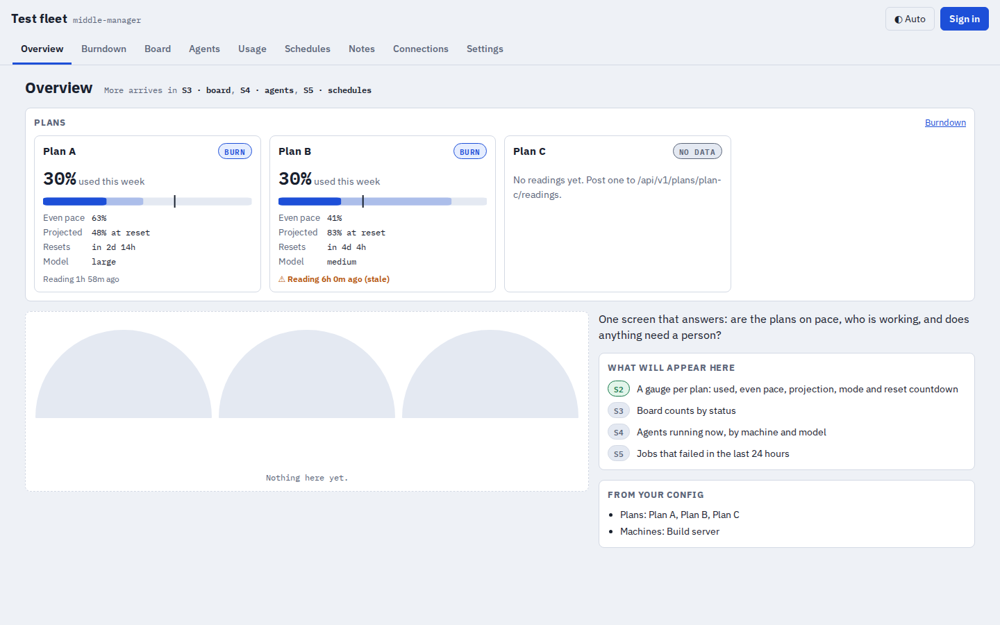
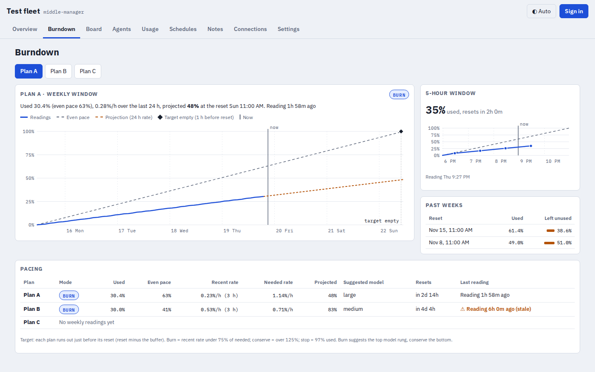
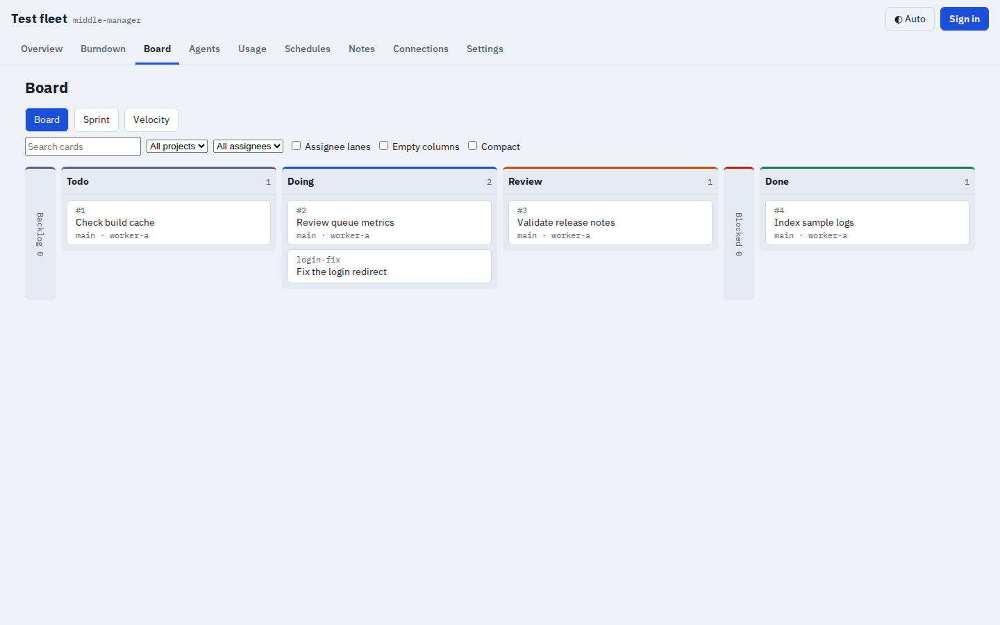
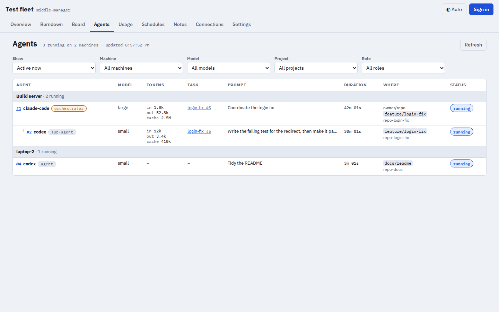
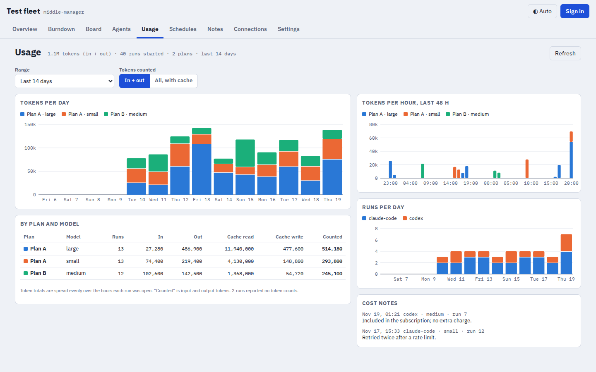
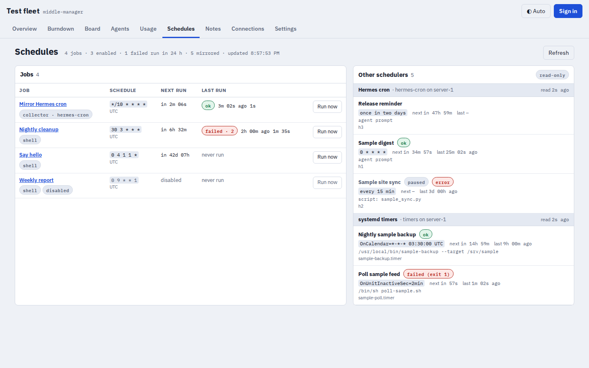
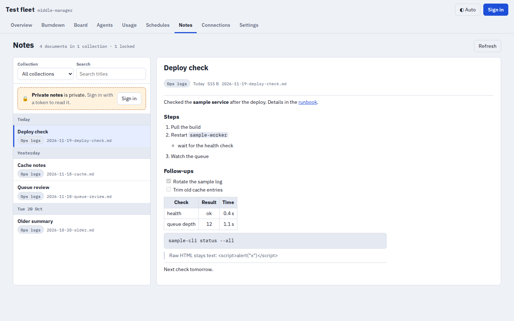
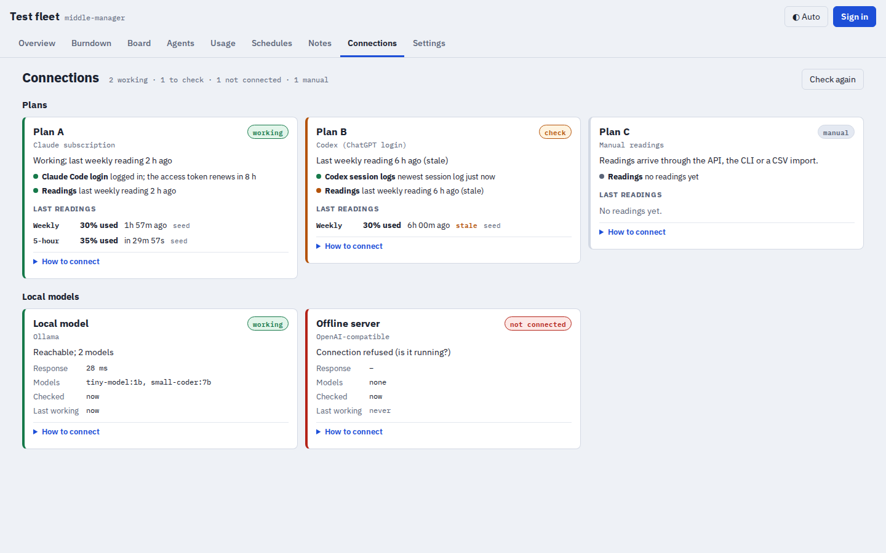
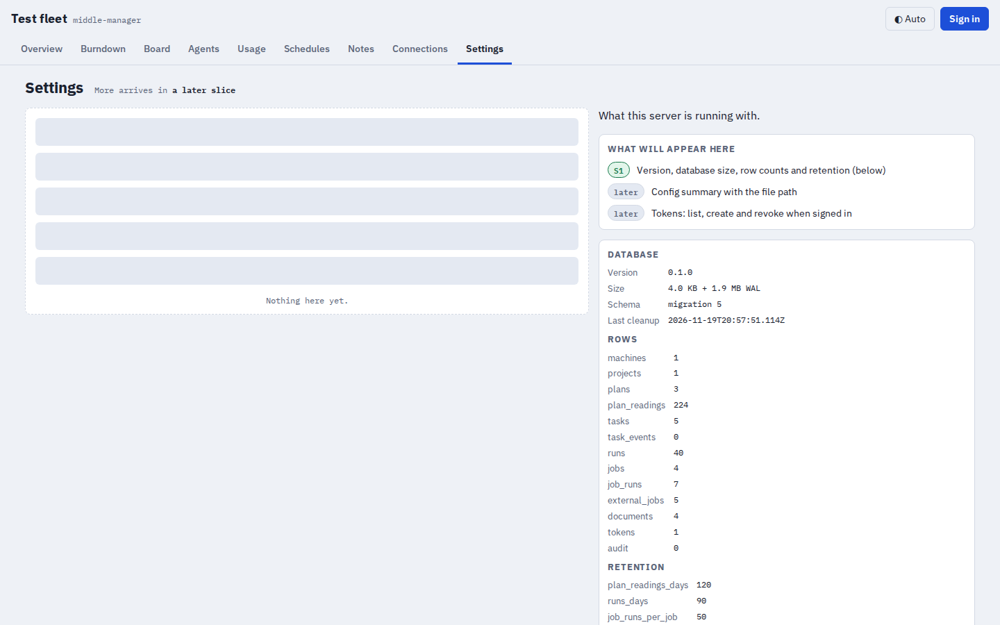
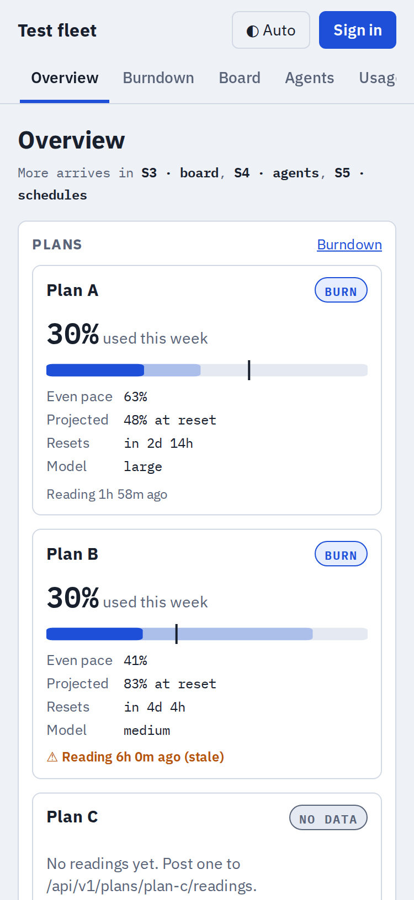

# middle-manager

_It watches others work, schedules meetings, and reports the burn._

A self-hosted dashboard and JSON API for keeping an eye on a fleet of AI coding agents:

- **Burndown**: how much of each subscription (Claude, Codex, ...) is used, whether it will run out
  before the reset, and which model tier agents should use to burn it evenly.
- **Board**: the work, as kanban cards with history, linked runs and branches.
- **Agents**: every agent run on every machine: model, tokens, task, prompt, duration, branch, and
  whether it is an orchestrator, agent or sub-agent.
- **Usage**: tokens per hour and per day by plan and model, runs per day, and cost notes.
- **Schedules**: cron jobs that collect usage and run checks, plus a view of other schedulers.
- **Notes**: ops logs, chat summaries and handoffs, rendered from markdown folders. Folders marked
  private need a token to read.
- **Connections**: how each plan and local model is connected, with a status check and the time of
  the last reading.

Runs as one Node process with one SQLite file. Anyone on your network can read; changes need an API
token. Machines, plans, models and folders all come from a config file, so you can point it at your
own setup.

Status: early development. See [SPEC.md](SPEC.md).

## The pages

Screenshots use the synthetic data from the end-to-end tests (`npm run screenshots` retakes them).

### Overview

One screen for "is anything wrong?": a gauge per plan with how much of the week is used, where an
even pace would be, the projection at the reset, the pacing mode and the reset countdown. Stale
readings are marked as stale. The other Overview items (board counts, agents now, failed jobs) are
still planned.



### Burndown

Per plan: the weekly window chart (readings, even-pace line, projection, target-empty marker and
"now"), the 5-hour window when the plan reports one, how much was left unused at each past reset,
and a pacing table with the mode (burn, steady, conserve, stop) and the suggested model rung.



### Board

Kanban columns by status that fit on one screen and scroll inside, loading cards as you scroll.
Search, project and assignee filters, optional lanes per assignee, a compact density, and empty
columns folded to a narrow strip. Done shows the last 14 days unless you ask for older cards. On
a phone, one column at a time. A card opens in a side sheet with its body, history and linked
agent runs. Cards imported from Hermes kanban boards are read-only. Sprint and Velocity views
group the same cards.



### Agents

Every agent run, grouped by machine: agent kind and role (sub-agents indented under their parent),
model, tokens in/out/cache, linked task, the first line of the prompt, live duration, origin,
branch and worktree, and status. Filter by machine, model, project, role or "finished in the last
N hours". Runs come from agents reporting themselves and from collectors that find running
processes.



### Usage

Where the tokens went: tokens per day and per hour stacked by plan and model, runs started per
day by agent kind, a table by plan and model, and any cost notes agents attached to their runs.
Count input and output only, or include cache reads and writes. A run's token totals are spread
evenly over the hours it was open.



### Schedules

middle-manager's own jobs (create, edit, enable, run now; the last runs with capped output) next
to a read-only mirror of Hermes cron jobs and systemd timers, so every scheduled thing on the host
is in one list. Shell jobs need a token with the `jobs:shell` scope.



### Notes

Markdown folders from the config, listed by date with title search and rendered on request (files
are read from disk, never copied into the database; raw HTML is shown as text). Folders marked
private stay locked until you sign in with a token.



### Connections

How each plan and local model is connected and whether it works right now: the Claude Code login
and Codex session logs on this host (credentials never leave it), local Ollama or
OpenAI-compatible servers with a live check, and the newest reading for each.



### Settings

Version, database size, row counts and retention rules, so you can see the database is staying
small. Token management and a config summary are planned.



Every page has a light and dark theme (follows the OS, with a toggle) and a phone layout.



## Quick start

```sh
npm ci && npm run build
cp config/middle-manager.example.yaml config/middle-manager.yaml   # then edit it
npx middle-manager token create laptop
npm start
```

Full steps, including the systemd user unit: [docs/install.md](docs/install.md).

Agents report their runs with one `curl` at start and one at end: [docs/agents.md](docs/agents.md).

Font credits: [NOTICE.md](NOTICE.md).

## License

MIT
